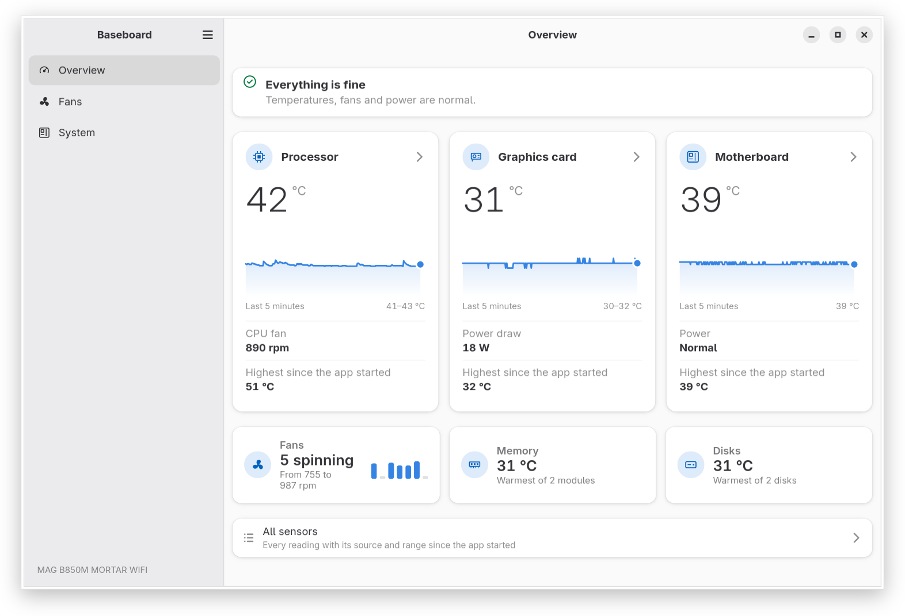
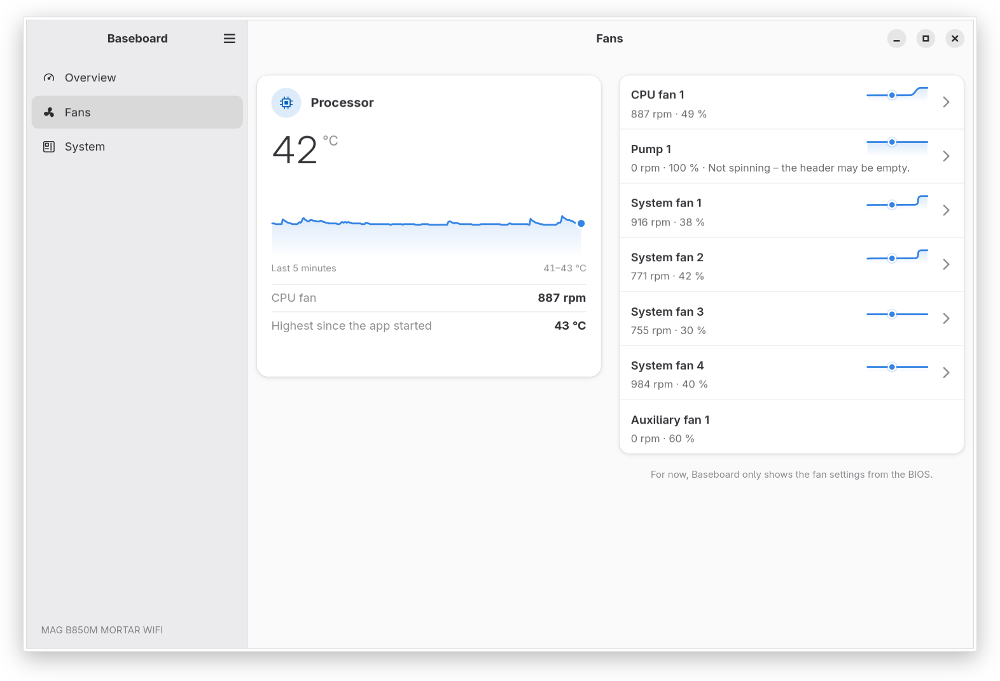

<p align="center">
  
</p>

<h1 align="center">Baseboard</h1>

<p align="center">A native GNOME app for the sensors and fans of MSI motherboards on Linux.</p>

<p align="center">Sensor readings work on any board. Fan header names and, later, fan control need a board profile; one is verified today: MAG B850M MORTAR WIFI.</p>

<p align="center">
  <a href="https://baseboard.bojanowski.me">Website</a> ·
  <a href="#install">Install</a> ·
  <a href="#report-your-board">Report a board</a>
</p>

<picture>
  <source media="(prefers-color-scheme: dark)" srcset="website/screenshots/0.2.0/overview-dark-en.png">
  
</picture>

> **Early version, read only.** The current release is 0.2.0, see [Install](#install): it shows readings, fan curves and system information and does not change any setting yet. The design, in Polish, is in [docs/PROJEKT.md](docs/PROJEKT.md).

## What it is for

- A native GNOME app (GTK 4, libadwaita) for MSI motherboards on Linux. The point of reference is the sensor and fan part of MSI Center on Windows.
- For sensors and fans it relies only on the kernel drivers and their standard hwmon interface in sysfs. It has no hardware access of its own: no I/O ports, `/dev/port` or `/dev/mem`, and nothing in user space writes to the embedded controller (EC).
- What it does today (0.2.0), read only:
  - an Overview with the processor, graphics card and board, each with its temperature over the last five minutes, the fans, memory and disks, and one sentence that says whether everything is fine; it warns when the processor gets very hot, when the CPU fan stops and when a voltage is outside its tolerance;
  - a Fans page with the speed and duty cycle of every fan, named after the headers in the board profile, and the curve the board runs each fan by, where the kernel driver reports curves (see [Roadmap and kernel support](#roadmap-and-kernel-support)); with the driver of a released kernel it shows the speeds and temperatures;
  - all sensors: every temperature, fan speed and voltage with its source and its range since the app started, voltages rated against their tolerance;
  - a System page with the board, BIOS, processor, memory, graphics card and disks, the details and the state of the fan driver one click away, and a "Copy Information" button for bug reports (no serial numbers or MAC addresses);
  - English and Polish.

<picture>
  <source media="(prefers-color-scheme: dark)" srcset="website/screenshots/0.2.0/fans-dark-en.png">
  
</picture>
- One verified board: **MAG B850M MORTAR WIFI (MS-7E61)**, PCB revision 1. On other computers Baseboard runs in a generic mode: readings without the board's header names and no fan control.

## Install

Baseboard comes as a Flatpak. A release on Flathub will be considered after fan control lands.

1. **Recommended: from the bojanowski.me repository.** It is signed and shared with the author's other apps. Updates come with a regular `flatpak update`; the GNOME runtime comes from Flathub.

   ```sh
   flatpak remote-add --user --if-not-exists flathub https://dl.flathub.org/repo/flathub.flatpakrepo
   flatpak remote-add --user --if-not-exists bojanowski https://flatpak.bojanowski.me/bojanowski.flatpakrepo
   flatpak install --user bojanowski me.bojanowski.Baseboard
   ```

2. **From the release file.** Download `me.bojanowski.Baseboard.flatpak` from the [latest release](https://github.com/TomaszBojanowski/baseboard/releases/latest) and install it. Flatpak takes the GNOME runtime from Flathub. A package installed this way does not update itself; install a newer release the same way.

   ```sh
   flatpak install --user me.bojanowski.Baseboard.flatpak
   ```

3. **From source:** see [Building](#building).

The Flatpak reads the sensors and the system information with read-only access to the udev database (`/run/udev`). Differences from a native installation:

- It does not see the system's lm-sensors configuration, so labels, `ignore` and `compute` statements from `/etc/sensors.d` do not apply; the board's readings still come scaled and named from its profile. To use the configuration, give the app read-only access to the whole of `/etc`:

  ```sh
  flatpak override --user --filesystem=host-etc:ro me.bojanowski.Baseboard
  ```

- It cannot see other programs that control fans, so the System page says it cannot check them.
- Its settings and own reading names are kept apart from a native installation, under `~/.var/app/me.bojanowski.Baseboard/`.

Fan control (M2) will need a system helper that cannot be part of a Flatpak; it will come as a separate system package.

## Roadmap and kernel support

Fan control on these boards depends on the `nct6683` kernel driver. Baseboard does not check the kernel version. It reads the sysfs attributes of each fan channel and decides from them what the driver allows, and shows this level on the System page. Since 0.2.0 it shows the fan curves where the driver reports them; fan control comes in a later version. From then on each level below unlocks by itself once the kernel provides it, without a new release of Baseboard.

If a patch in review changes its interface, Baseboard will have to follow it. Choosing the temperature source will be enabled only for the interface that is sent to the mailing list.

| Level | What Baseboard does | What it needs from the kernel | State in the kernel |
|---|---|---|---|
| Read only | Readings and fan speeds, with a note that control needs a newer driver (0.2.0) | The `nct6683` driver for the board's NCT6687D-R chip | In current kernels (checked with Fedora's 7.3.3 kernel) |
| Manual control | A fixed duty cycle per header, set through the helper (later) | Writable `pwmN` and `pwmN_enable`: manual fan control for MSI boards with NCT6687D-R, and its restore after resume | In `hwmon-next`, the hwmon maintainer's tree; not in a released kernel yet |
| Curve view | The fan curves stored in the EC and their temperature source, read only (0.2.0) | Readable `pwmN_auto_point*` and `pwmN_auto_channels_temp` | In `hwmon-next`; not in a released kernel yet |
| Curve editing | Editing the seven-point curves in the EC; they keep working without the app (later) | Writable `pwmN_auto_point*` | Patches in review on linux-hwmon: [v1 thread](https://lore.kernel.org/linux-hwmon/20261109223442.509238-1-tomasz@bojanowski.me/) |
| Temperature source | Choosing the sensor a curve follows (later) | Writable `pwmN_auto_channels_temp` | Planned, not sent yet |

Patches in review may change or may not be accepted. Kernel versions are not given until the patches are in the mainline tree.

### Next

- **M2, fans:** after the curve view of 0.2.0, a small system helper (D-Bus and polkit) that is the only part allowed to change fan settings, then manual mode and a curve editor. The helper follows fixed safety rules:
  - minimum duty cycles for the CPU fan and the pump;
  - the pump never stops;
  - curves for the CPU and the pump reach 100 % by the emergency temperature;
  - headers in manual mode return to firmware control when the helper exits or crashes, before shutdown, and when a temperature passes its emergency threshold;
  - settings last until the next reboot;
  - control only on a board whose profile matches, PCB revision included, and only on headers whose writes were tested on that board.
- **More boards:** profiles of other boards only from their manuals, public sources and tests on the hardware. Until the header mapping is tested, such a profile shows readings and names without fan control.

### Under consideration

These are ideas without a schedule, and they may not happen:

- onboard RGB lighting (M3);
- power profiles and restarting into the firmware setup (M4);
- help with BIOS updates without flashing from the running system (M5).

## Kernel work

Support for this board in the Linux kernel is being developed alongside the app, in the mainline kernel tree.

hwmon (sensors and fans):

- In the mainline tree, not in a released kernel yet: the board added to the [list of tested boards](https://git.kernel.org/pub/scm/linux/kernel/git/torvalds/linux.git/commit/?id=f9c5d495e22f77c0455dacfca627e06219f05881) in the `nct6683` documentation (`f9c5d495e22f`).
- In `hwmon-next`: a [driver for the voltage sensors of the RGB controller](https://patch.msgid.link/20261107082821.8257-1-tomasz@bojanowski.me) (`msi_mystic_light`) with documentation and a MAINTAINERS entry; in `nct6683`, the [32 mV voltage scale removed](https://patch.msgid.link/20261107150619.297999-1-tomasz@bojanowski.me), the [fan curves reported](https://patch.msgid.link/20261109015759.24284-1-tomasz@bojanowski.me) with documentation and [manual fan control restored after resume](https://patch.msgid.link/20261109163328.61787-1-tomasz@bojanowski.me); Tested-by on [four changes to the `msi_mystic_light` driver](https://patchwork.kernel.org/series/1205153/).
- In review: [two `nct6683` patches](https://lore.kernel.org/linux-hwmon/20261109223442.509238-1-tomasz@bojanowski.me/) that make the fan curves writable, with documentation.

Sound:

- In released kernels: a [usb-audio mixer mapping](https://git.kernel.org/pub/scm/linux/kernel/git/torvalds/linux.git/commit/?id=7b457ae8cf711831f19d20963f5ed2fdf4842d3a) for this board (`7b457ae8cf71`).

## Report your board

Open an issue at <https://github.com/TomaszBojanowski/baseboard/issues> and paste the text from **System → Copy Information**. It holds the board model and code, the BIOS, the hwmon devices and the fan driver level, and no serial numbers or MAC addresses.

## Building

Requires Rust 1.92 or newer, GTK 4.22, libadwaita 1.9 and Meson 1.1.

```sh
meson setup build
meson compile -C build
meson test -C build
# run without installing, with the settings schema of the build directory
meson devenv -C build ./crates/app/baseboard
```

### Flatpak

The manifest is in `build-aux/flatpak/`. It uses the GNOME 51 runtime and builds libsensors from lm-sensors. The Rust dependencies come from `cargo-sources.json`, so Cargo does not need the network during the build. After a change of `Cargo.lock`, generate that file again with `flatpak-cargo-generator.py` from [flatpak-builder-tools](https://github.com/flatpak/flatpak-builder-tools).

```sh
flatpak-builder --user --install --install-deps-from=flathub --force-clean \
    build/flatpak build-aux/flatpak/me.bojanowski.Baseboard.json
flatpak run me.bojanowski.Baseboard
```

The differences from a native installation are listed under [Install](#install).

## How Baseboard is developed

Baseboard is developed with the help of an AI assistant (Claude Code). The direction, the design decisions, the review of changes and the tests on the hardware are by Tomasz Bojanowski.

## License

GPL-3.0-or-later, see [LICENSE](LICENSE).

## Trademarks

MSI, MSI Center and MSI product names are trademarks of Micro-Star International Co., Ltd. Baseboard is an independent project and is not affiliated with or endorsed by MSI.
